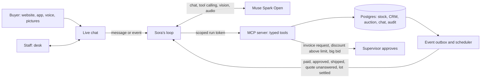

# AutoFTE

**A used-car exporter's whole business on one platform, with an AI employee doing the sales agent's job.**
Built with **Muse Spark Open**, Meta's open-weight model. MIT licensed. Demo data only (a fictional exporter, Hikari Motors).

Japanese used-car exporters sell to buyers in Africa, the Caribbean, the Gulf and Asia. Every sale is pushed by hand: an
agent answers chats at all hours, searches auction lists, reads hand-written Japanese auction sheets, works out the landed
price to a far-off port, and raises the invoice. Buyers who message at 2 a.m. are lost by morning.

AutoFTE is that flow as one white-label product (website, CRM, auction, live chat, app), run by **Sora**, a Digital FTE: a
full-time AI employee who holds the sales agent's seat, in the same chat, with a named account, limits and an audit trail.
People stay in charge of what matters: **Sora cannot issue an invoice or take a payment. A Supervisor approves, in one click.**

## Run it

You need Node 20.12 or newer and a [Baseten](https://www.baseten.co/) key for Muse Spark Open.

```bash
git clone <this repo> autofte && cd autofte
cp .env.example .env     # paste your key into BASETEN_API_KEY
npm install
npm run setup            # creates the embedded Postgres in .data/ and loads the demo company
npm run dev              # open http://localhost:5173
```

There are no passwords to find: `/login` has one-click demo buttons for Customer, Agent, Supervisor, Manager, Admin and
Accounts. No Docker or database install is needed. Without a key everything runs except Sora, who then tells the buyer a
team member will reply.

## Five minutes with it

1. **Sell.** Open the site, press the chat button, and write
   `I need a Toyota Hilux under $30,000, shipped to Mombasa`. Sora shows real cars from stock with an exact C&F price, and
   the lines it is made of. Reply in Urdu, Swahili or Arabic, or send a voice note: Sora follows you.
2. **Close.** Write `OK, I'll take the second one`. Sora collects what is missing, creates the lead and asks for the invoice.
3. **Approve.** Sign in as **Supervisor**, open CRM, Invoices, the request marked *Sora*. Read Sora's audit trail, change
   anything you like with *Edit invoice*, then approve. The buyer's chat gets the invoice and the bank details straight away.
   Add the final PDF and mark it as sent.
4. **Auction.** As Customer, open Auction, pick a lot and press *Ask Sora to read the sheet*. The sheet is an image;
   Muse Spark Open reads it. Ask Sora to bid: inside its limit it bids, above it a Supervisor must agree.
5. **Watch.** As Manager, open the Sora console: live activity, every tool call, what it may do without asking, and its
   eval suite. On *Schedule & clock*, move the clock a day forward and watch it follow up with buyers by itself.
6. **Rebrand.** As Admin, open Branding, change the company, the AI's name, the logo and the colours. The site, the invoices
   and Sora's own words follow. *Reset demo* puts everything back in seconds.

## How Sora works



- **Tools, not access.** Sora reaches the business only through 19 typed tools on the platform's own MCP server, with a
  short-lived token bound to one conversation and one buyer. It has no tool to issue an invoice, record a payment or run SQL.
  Limits (discount, bid, proactive messages per day, working hours) are checked **on the server inside each tool**, so no
  prompt can talk it past them. Staff change them on a screen.
- **Skills.** Know-how lives in nine `skills/*/SKILL.md` files. Only their names and descriptions sit in the prompt; the
  body is loaded with `load_skill` when the work calls for it.
- **Grounded.** Prices come from a deterministic engine (`services/pricing.ts`), never the model's arithmetic. Stock numbers,
  balances and dates come from tool results.
- **Words match actions.** If a reply promises a person but the model skipped the handover, the server hands over itself. If
  a reply says "let me check that" with no tool call, or answers a plain yes with "shall I...?" and no work done, the buyer
  never sees it: the model is sent back to do the work. All three are recorded as code guards.
- **It works when nobody writes.** Events wake it: an invoice approved, a payment received, a stage shipped, a quote
  unanswered for 24 hours, an auction day settled, a promised follow-up falling due, a wanted car arriving in stock.
- **Everything is audited.** Every run records its trigger, tool calls, arguments, results, tokens and latency, and every
  business change has an audit row with who did it, person or Sora.
- **Evals.** `npm run eval` runs 48 cases on the live model through the real tools: fresh test buyers, answers checked
  against the database, everything removed afterwards. Safety cases block a release. The last full run passed 47 of 48 with
  no safety failure; a model's replies vary, so a case or two can move between runs. The suite found real bugs while this
  was being built, including the two guards above.

## Meta's model, and why it matters here

Every model call at runtime is Muse Spark Open (`meta-models/muse-spark-open-1026`), one model doing four jobs:

| Job | Where |
| --- | --- |
| Conversation in the buyer's language, with tool calling | `apps/server/src/fte/agent.ts` |
| Vision: reading the auction sheet **image**, not a database field | `apps/server/src/fte/sheetReader.ts` |
| Audio: a voice note, heard once and kept as text under the bubble | `apps/server/src/fte/voice.ts` |
| A running summary of each conversation, shown to staff and fed back to Sora | `apps/server/src/fte/agent.ts` |

An exporter's data is its business, and its volumes are small and spiky. Open weights mean the same employee can run on any
provider or on its own hardware, without changing a line of the product. `.env` already takes a second provider as a
fallback. "Listen" in the chat uses the browser's own speech, not a model.

## What is in the box

| Part | What it does |
| --- | --- |
| **Website** | Home (19 editable sections), world clocks and the yen rate, shop with suggestions, filters and price range, car cards with save and add to cart, car pages with gallery and video, wishlist, cart, checkout, guides, FAQ, forgotten password by link, newsletter sign-up; customer account with invoices, shipping progress and documents |
| **CRM** | Leads (filters, Excel import, assign by country, transfer, statuses), Customers view with invoiced, paid and balance, invoice request, Supervisor edit and approval, final PDF before sending, PDF and Excel on three letterheads, payments, units with six document folders and costing, shipping progress, reports in Excel and Word, users and roles, full backup workbook |
| **Auction** | Lots across fictional halls with rendered sheets, Excel import of your own lots, a list that refreshes itself, bids and orders, past prices by hall, engine and date, enquiries, an admin side with every lot, a client-to-paid-order funnel, who did what, and a measured working signal |
| **Live chat** | One thread on the site, desk and app: pictures, voice notes, one, two and blue ticks, links, emoji, talk to a person, take over and hand back, team DMs and groups, presence, voice and video calls; staff drill down agent then customers |
| **Website admin** | Vehicles, home sections, pages, guides, FAQ, brands and models, customers (one-time passwords in bulk, CRM customers with no e-mail), orders, messages, newsletter list, media library, branding, roles and permissions |
| **Android app** | Home, shop with every filter, car pages, cart, checkout, account, forgotten and changed passwords, the same chat with Sora and the team, voice and video calls, push notifications (`apps/mobile`, Expo) |

The app is on the [Releases](../../releases) page. On first launch it asks for the server's address, for example
`http://192.168.1.20:8787` after `npm run build && npm start` on a laptop on the same Wi-Fi. To build it yourself:
`cd apps/mobile && npm install && npx expo run:android`.

Other commands: `npm run build && npm start` (one process serves the site, API and MCP on :8787), `npm test`, `npm run typecheck`,
`npm run lint:secrets`. Set `DATABASE_URL` to use your own Postgres; the demo and all tests ran on the embedded one.

## What it does not do

- All data is fictional. Import rules per country are demo data, and the screen says so.
- There is no online payment. Card or PayPal checkout is not built: buyers pay by bank transfer and staff record the payment.
- Reset links go by e-mail only if you set `SMTP_URL`. Without it, demo mode shows the link on the page, and outside demo mode a person issues a one-time password.
- Client stories on the home page are pictures, not videos. A car's own video works if you add its link.
- Calls across strict networks need a TURN relay (`TURN_URL` in `.env`). None is bundled.
- Push notifications need your own Firebase project (`FIREBASE_SERVICE_ACCOUNT` in `.env`, `google-services.json` for the app).
- One company per deployment; it is white-label, not multi-tenant.

## Where it came from

Everything here was written during the Meta Global AI Developer Hackathon, from 30 October 2026. The repo holds no code, data
or assets from any earlier project. The flow it automates comes from what the author saw of a real used-car export business.
Car photos are real photos from Wikimedia Commons under free licences (CC0, public domain, CC BY, CC BY-SA), resized only. Each photographer and licence is listed on the `/credits` page and in `apps/web/public/cars/credits.json`; the MIT licence covers the code, not those photos. Auction sheets and the extra car views are drawn by code (`services/carArt.ts`, `services/sheets.ts`). The yen rate on the site comes from the European Central Bank's public rates through frankfurter.dev, with no account; prices never use it. Claude Code was the coding tool; every model the product calls at runtime is Meta's. Specs, plan and tasks are in `specs/001-autofte-platform`.

Built on Express, Drizzle, PGlite, React, Vite, Tailwind, TanStack Query, Expo, the MCP TypeScript SDK, ExcelJS, PDFKit, docx, Nodemailer and resvg.
