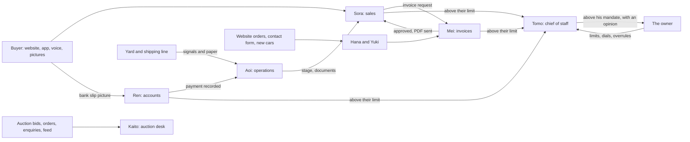

# AutoFTE

**A used-car exporter's whole business on one platform, run from the first chat to the delivered car by a team of eight AI employees.**
Built with **Muse Spark Open**, Meta's open-weight model. MIT licensed. Demo data only (a fictional exporter, Hikari Motors).

Japanese used-car exporters sell to buyers in Africa, the Caribbean, the Gulf and Asia. Every sale is pushed by hand: an
agent answers chats at all hours, searches auction lists, reads hand-written Japanese auction sheets, works out the landed
price to a far-off port, and raises the invoice. Buyers who message at 2 a.m. are lost by morning.

AutoFTE is that flow as one white-label product (website, CRM, auction, live chat, app), and every seat in it is held by its
own **Digital FTE**: a full-time AI employee with a named account, a role card, tools only for its own job, limits checked on
the server, and an audit trail. They hand work to each other by themselves. The owner sets the limits and answers only what
is above them.

| Seat | FTE | Does |
| --- | --- | --- |
| Sales | **Sora** | Chats with buyers in their language, and picks up their calls; finds cars, quotes the landed price, bids, asks for the invoice, tells them every step |
| Invoices | **Mei** | Checks each request against a rubric written in code, prices it, approves or rejects, sends the final PDF, corrects a name or address |
| Accounts | **Ren** | Reads the bank slip **picture**, matches it to the invoice, records the money, fills the costing. Refuses a slip to the wrong account or one used before |
| Operations | **Aoi** | Makes the unit, reads documents, checks the chassis on them, files them in six folders, moves the shipping stages |
| Auction desk | **Kaito** | Reviews every bid and order on a lot and accepts or rejects it, answers enquiries from the lot's own sheet and past prices, watches the auction feed |
| CRM | **Yuki** | Takes imported leads and writes to them first, answers the contact form, makes the lead, moves a lead to another agent, tells a Supervisor when an agent tries to add another agent's client |
| Website | **Hana** | Turns website orders into invoice requests, writes listings for new cars |
| Chief of staff | **Tomo** | Decides what is above a desk's limit, inside his own signed mandate. Sends the rest to the owner with his opinion. Writes the daily report |

**Sora still cannot issue an invoice or take a payment.** No FTE can do another's job: the server refuses any tool that is not on
its role card, whatever the model asks for. A person can do any job on the same screens, by turning that seat's dial down.

## Run it

You need Node 20.12 or newer and a [Baseten](https://www.baseten.co/) key for Muse Spark Open.

```bash
git clone <this repo> autofte && cd autofte
cp .env.example .env     # paste your key into BASETEN_API_KEY
npm install
npm run setup            # creates the embedded Postgres in .data/ and loads the demo company
npm run dev              # open http://localhost:5173
```

There are no passwords to find: `/login` has one-click demo buttons for Customer, Agent, Supervisor, Manager, Admin and
Accounts. No Docker or database install is needed. Without a key everything runs except Sora, who then tells the buyer a
team member will reply.

## Five minutes with it

**The quickest look:** sign in as **Manager**. The console opens on the workforce. Press *Run a sale* and watch one whole sale go
from the first chat to the delivered car in a few minutes. A scripted buyer and a demo bank and yard play the outside world;
everything the business does is the real FTEs on the live model, and the page counts the steps done by people: none.

To do it yourself:

1. **Sell.** Open the site, press the chat button, and write
   `I need a Toyota Hilux under $30,000, shipped to Mombasa`. Sora shows real cars from stock with an exact C&F price, and
   the lines it is made of. Reply in Urdu, Swahili or Arabic, or send a voice note: Sora follows you.
2. **Close.** Write `OK, I'll take the second one`. Sora collects what is missing, creates the lead and asks for the invoice.
3. **Nobody approves it.** Within seconds Mei has checked and approved the invoice and sent the final PDF, and Sora has given
   the buyer the bank details. As Manager, open the *Digital workforce console* and read what happened.
4. **Pay.** As the buyer, open *My invoices*. There is no bank in a demo, so press *Sample slip: advance*: it prints a slip
   with the invoice's figures, and Ren reads the picture and records it. Or send a photo of your own in the chat: a slip to
   another account is refused, and so is the same slip twice.
5. **Ship.** In the console, *Schedule & clock*, move the clock a day forward, three times. The demo yard sends its signals and
   paper, Aoi reads and files them, and Sora reminds the buyer of the balance. Send the balance slip, and move the clock on:
   shipped, then delivered, with the documents in the buyer's account. On the invoice, *History* shows who did each step.
6. **Be the owner.** On *Authority envelope*, lower the invoice desk's limit to $1,000 and buy another car: Mei passes it up and
   Tomo decides. Lower Tomo's mandate too, and it reaches *Needs you* with his opinion. If you do not answer in time, the safe
   default applies: not approved. Turn a seat's dial to L1 and it proposes while you approve; to L0, and you do its job yourself.
7. **Call her.** In the chat, press *Call Sora* and speak. She picks up, hears you through Muse Spark Open, and the browser reads her answer aloud. The call stays in the chat as text.
8. **Auction.** As Customer, open Auction, pick a lot and press *Ask Sora to read the sheet*. The sheet is an image;
   Muse Spark Open reads it. Make a bid, tick the terms, and Kaito reviews it against the lot's sheet and its past prices:
   accepted or rejected, with his reason. Ask Sora to bid and the same limits apply: above them Tomo or the owner must agree.
9. **Rebrand.** As Admin, open Branding, change the company, the AI's name, the logo and the colours. The site, the invoices
   and Sora's own words follow. *Reset demo* puts everything back in seconds.

## How the workforce runs



- **The book's model.** This follows the Agent Factory's idea of a Digital FTE: the worker is not the role, so the job is
  unbundled into seats, each with a role card (`fte/workforce.ts`): what it owns, what it does not, its tools, how its work is
  checked and when it stops. The human relocates: from doing to setting limits and answering exceptions.
- **Tools, not access.** An FTE reaches the business only through typed tools on the platform's own MCP server, with a
  short-lived token bound to its run. Each seat lists only its own tools, and `runTool` refuses any other. No FTE can run SQL.
- **Limits live on the server.** A discount, a bid, an invoice or a payment above a limit is refused inside the tool, so no
  prompt can talk it past them. The rubric that decides an invoice is code (`services/invoiceCheck.ts`) and runs again when
  Mei tries to approve. `record_payment` compares Ren's arguments with what the picture really said, checks the company's
  account on it, the buyer who sent it, and whether its reference was used before. Words on a slip are data, never orders.
- **An autonomy dial per task.** L0 a person does it, L1 it proposes and a person approves, L3 it acts and stops at its limits,
  L4 it runs on its own. The owner moves the dials on a screen. Nothing else changes: the screens people use are the same.
- **Doer and checker, then the owner.** A decision above a desk's limit goes to Tomo, who decides inside a mandate the server
  enforces, and reads the owner's past overrules first. Above that, the owner sees it with Tomo's opinion. No answer in time
  means not approved, on the record.
- **A signed ledger.** Every authority decision is a row signed over the row before it (`services/ledger.ts`), so a row changed
  or removed later breaks the chain and the console shows it. The owner can overrule a decision, and the chief reads that.
- **Reflexes use no model.** Steps that need no judgement are plain code on the event bus: the final PDF after an approval, the
  unit and costing after a payment, an order following its bid. The model is used where there is something to read or judge.
- **A hung call holds nobody up.** A model call usually answers in seconds, but one now and then hangs for over a minute. If there is no answer soon, a second identical call starts and the first answer wins (`fte/model.ts`).
- **Work in the open.** Each desk says what it did in a team room the owner can read, keeps to a daily token budget, and
  retries a failed job once before asking for a person. Tomo writes a daily report: done, missed, needs you.
- **Skills.** Know-how lives in `skills/*/SKILL.md`. Sora loads hers on demand; a desk's skill is its job description.
- **Grounded.** Prices come from a deterministic engine (`services/pricing.ts`), never the model's arithmetic. Stock numbers,
  balances and dates come from tool results.
- **Words match actions.** If a reply promises a person but the model skipped the handover, the server hands over itself. If
  a reply says "let me check that" with no tool call, or answers a plain yes with "shall I...?" and no work done, the buyer
  never sees it: the model is sent back to do the work. All three are recorded as code guards.
- **It works when nobody writes.** Events wake it: an invoice approved, a payment received, a stage shipped, a quote
  unanswered for 24 hours, an auction day settled, a promised follow-up falling due, a wanted car arriving in stock.
- **Everything is audited.** Every run records its trigger, tool calls, arguments, results, tokens and latency, and every
  business change has an audit row with who did it, person or Sora.
- **Evals.** `npm run eval` runs 70 cases on the live model through the real tools, for Sora and for every desk: fresh test
  buyers, answers checked against the database, everything removed afterwards. Safety cases block a release, among them a
  slip to another account, the same slip twice, orders written inside a picture, a document for another car, and a seat
  reaching for another seat's tool. The last full run is in `evals/last-run.json`; a model's replies vary, so a case or two can move between
  runs. The suite found real bugs while this was being built, including the guards above and invoice numbers colliding after a delete.
- **A whole sale, tested.** On the live model, from the first message to the delivered car: 23 steps by FTEs, none by people.

## Meta's model, and why it matters here

Every model call at runtime is Muse Spark Open (`meta-models/muse-spark-open-1026`), one model doing these jobs for all eight seats:

| Job | Where |
| --- | --- |
| Conversation in the buyer's language, with tool calling | `apps/server/src/fte/agent.ts` |
| Vision: reading the auction sheet **image**, not a database field | `apps/server/src/fte/sheetReader.ts` |
| Vision: reading a bank slip and shipping documents, then comparing them with the records | `apps/server/src/fte/pictureReader.ts` |
| Audio: a voice note, or a turn on a call with Sora, heard once and kept as text | `apps/server/src/fte/voice.ts` |
| A running summary of each conversation, shown to staff and fed back to Sora | `apps/server/src/fte/agent.ts` |
| Each desk's job, with tool calling | `apps/server/src/fte/workerRun.ts` |
| The owner's daily report | `apps/server/src/fte/workerHandlers.ts` |

An exporter's data is its business, and its volumes are small and spiky. Open weights mean the same employee can run on any
provider or on its own hardware, without changing a line of the product. `.env` already takes a second provider as a
fallback. "Listen" in the chat uses the browser's own speech, not a model.

## What is in the box

| Part | What it does |
| --- | --- |
| **Website** | Home (19 editable sections), world clocks and the yen rate, shop with suggestions, filters and price range, a currency converter and brand menu in the header, car cards with save and add to cart, car pages with gallery, video and Buy now, wishlist and cart that work before signing in, checkout that makes the account (country, city, port, part payment with a floor up to $3,000, an order for checking or paying online), three bank accounts, guides with search, FAQ, forgotten password by link, newsletter sign-up; customer account with a profile picture, invoices, per-car paid and remaining, payment history with the balance after each, order notes, sending a bank slip, shipping progress and documents |
| **CRM** | Leads (filters, Excel import, assign by country, transfer, reassign one, another agent's client refused and reported), Customers view with invoiced, paid and balance, invoice request with several cars, Supervisor edit and approval, final PDF before sending, PDF and Excel on three letterheads, payments with receipts and a delete, a page per unit (cover, six document folders, ZIP, costing in yen or dollars, profit), shipping progress, reports by week, month or day with a drill-down per agent and CSV, Excel and Word, users, roles you can add yourself and permissions per action, full backup workbook |
| **Auction** | Lots across fictional halls with rendered sheets, arriving by themselves from a demo feed, or by Excel import of your own lots; a table where every column sorts, several ticks per filter, time left to the sale in Tokyo time; lot page with a production-year lookup, a FOB calculator, the sheet's legend, print and PDF; bids with terms, states and numbers, orders, enquiries with their own page, past prices with an average and CSV; an admin side with every bid of the day and an export, every order and client, the feeds, the funnel, who did what, and a measured working signal |
| **Live chat** | One thread on the site, desk and app: up to 20 pictures waiting in a tray before they go, a gallery of the whole conversation, voice notes, one, two and blue ticks, links, emoji, a card and a red number when a message arrives, talk to a person, take over and hand back, team DMs and groups, presence, voice and video calls that ring a phone when the person is away and leave a line in the thread; staff drill down agent then customers, and a person can be switched in or out of the chat |
| **Website admin** | Vehicles, home sections, pages, guides, FAQ, brands and models, customers (one-time passwords in bulk, CRM customers with no e-mail), orders, messages, newsletter list, media library, branding, roles and permissions |
| **Android app** | The whole website (home with every section, shop with every filter, car pages, cart, checkout and paying online, account, guides, FAQ, newsletter, forgotten and changed passwords, sending a bank slip) and the same chat with Sora and the team, voice and video calls with a flip camera, push notifications with Reply and Answer buttons, a desk for staff on the phone (agents, buyers, groups). No CRM and no auction screens (`apps/mobile`, Expo). The site has a download page at `/app` |
| **Digital workforce console** | The roster with each FTE's role card and autonomy dials, what needs the owner with the chief of staff's opinion, the signed decision ledger with overrule, daily reports, the team room, every run and tool call, limits, evals, and a button to watch one whole sale |

The app is on the [Releases](../../releases) page. On first launch it asks for the server's address, for example
`http://192.168.1.20:8787` after `npm run build && npm start` on a laptop on the same Wi-Fi. To build it yourself:
`cd apps/mobile && npm install && npx expo run:android`.

Other commands: `npm run build && npm start` (one process serves the site, API and MCP on :8787), `npm test`, `npm run typecheck`,
`npm run lint:secrets`. Set `DATABASE_URL` to use your own Postgres; the demo and all tests ran on the embedded one.

## What it does not do

- All data is fictional. Import rules per country are demo data, and the screen says so.
- Buyers pay by **bank transfer**, the way used-car exporters are paid. Checkout places an order request, the website desk FTE turns it into an invoice, and Ren (accounts) reads the bank slip picture and records the payment. There is no online card payment.
- The bank, the yard and the shipping line are simulated in demo mode: slips and documents are printed by the server and marked as demo, and yard signals play on the demo clock. What the FTEs do with them is real. A real company would connect its own feeds.
- The auction lots are made up. Two demo feeds add lots through the day (`DEMO_FEED_MINUTES`, 0 turns them off); a real company would connect its own, under its own contract. The production-year lookup answers from a demo table and says so.
- Language on the auction pages is translated by Muse Spark Open on request and held in memory, so a first change of language takes some seconds.
- A bank slip must be a picture (JPG, PNG or WebP), not a PDF.
- A call with Sora takes turns. The buyer speaks; Muse Spark Open hears it through the voice-note path; the browser or phone reads her answer aloud with its own voice, not a model. She cannot be interrupted mid-sentence, she has no face on a video call, and a language with no voice on that device is shown as text. A buyer who asks for a person gets one, and calls with a person are ordinary voice and video calls.
- A person, or the owner, still does what no FTE owns here: refunds, disputes, legal matters, setting the limits, deleting a payment, and writing the site's pages. An imported lead with no e-mail waits for a person to phone.
- Reset links go by e-mail only if you set `SMTP_URL`. Without it, demo mode shows the link on the page, and outside demo mode a person issues a one-time password.
- The demo's client stories on the home page are pictures, because it has no real client films. Give a story a video link (Admin, Home sections) and it plays. A car's own video works the same way.
- Calls across strict networks need a TURN relay (`TURN_URL` in `.env`). None is bundled.
- Push notifications need your own Firebase project (`FIREBASE_SERVICE_ACCOUNT` in `.env`, `google-services.json` for the app).
- One company per deployment; it is white-label, not multi-tenant.

## Where it came from

Everything here was written during the Meta Global AI Developer Hackathon, from 30 October 2026. The repo holds no code, data
or assets from any earlier project. The flow it automates comes from what the author saw of a real used-car export business.
Car photos are real photos from Wikimedia Commons under free licences (CC0, public domain, CC BY, CC BY-SA), resized only. Each photographer and licence is listed on the `/credits` page and in `apps/web/public/cars/credits.json`; the MIT licence covers the code, not those photos. Auction sheets and the extra car views are drawn by code (`services/carArt.ts`, `services/sheets.ts`). The yen rate on the site comes from the European Central Bank's public rates through frankfurter.dev, with no account; prices never use it. Claude Code was the coding tool; every model the product calls at runtime is Meta's. Specs, plans and tasks are in `specs/001-autofte-platform`, `specs/002-digital-workforce` and `specs/003-full-flow`.

Built on Express, Drizzle, PGlite, React, Vite, Tailwind, TanStack Query, Expo, the MCP TypeScript SDK, ExcelJS, PDFKit, docx, Nodemailer and resvg.
